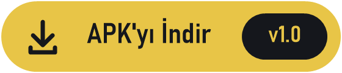
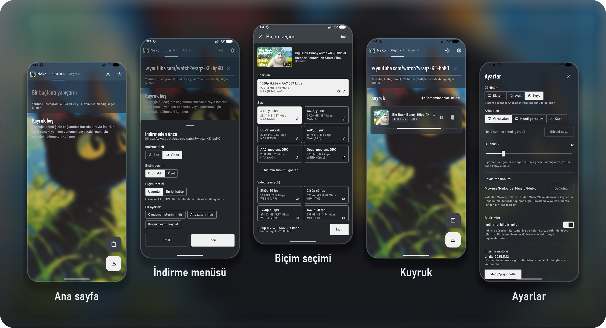

<div align="center">


# Neko Downloader

**YouTube, Instagram, X, Reddit ve daha yüzlerce siteden video ve müzik indiren hızlı bir Android uygulaması.**

[](https://github.com/TozluMercek/neko-downloader/releases/latest)
[](https://github.com/TozluMercek/neko-downloader/releases)


<br />

<a href="https://github.com/TozluMercek/neko-downloader/releases/latest">
  
</a>

<br /><br />

</div>

## 📸 Ekran görüntüleri

<a href="docs/screenshots">
  
</a>

## ✨ Özellikler

<table>
<tr>
<td width="50%" valign="top">

### 📥 İndirme
- **Çoklu site desteği:** YouTube, Instagram, X (Twitter), Facebook, Reddit ve [yt-dlp](https://github.com/yt-dlp/yt-dlp)'nin desteklediği yüzlerce site
- **İndirme kuyruğu:** Bağlantılar sırayla indirilir; duraklat, devam ettir, yeniden dene
- **Oynatma listeleri:** Listedeki tüm videolar ayrı bir klasöre indirilir
- **Arka planda indirme:** Uygulama kapalıyken bile indirme sürer

</td>
<td width="50%" valign="top">

### 🎞️ Biçim ve kalite
- **Hazır profiller:** *En iyi kalite* veya *her cihazda oynar* (H.264 + AAC, MP4)
- **Ayrıntılı biçim seçimi:** Ses ve görüntüyü tek tek seç, Neko ikisini birleştirir
- **Yalnızca ses:** MP3, M4A (AAC) ve Opus
- **Altyazı:** Dil seçerek indir, videoya gömülür
- **Küçük resim:** Videonun kapak görselini JPG olarak kaydet

</td>
</tr>
<tr>
<td width="50%" valign="top">

### ⚡ Hızlı kullanım
- **Paylaş menüsü:** Herhangi bir uygulamadan *Neko* ile aç veya tek dokunuşla **Hızlı İndir**
- **Pano algılama:** Kopyaladığın bağlantı otomatik yakalanır
- **Bildirimler:** İlerleme, hız ve kalan süre; bitince dosyayı bildirimden aç veya paylaş

</td>
<td width="50%" valign="top">

### 🎨 Görünüm ve arşiv
- **Arşiv:** Biten indirmeleri ara, oynat, paylaş veya sil
- **Açık / koyu / sistem teması**
- **Bulanık cam arka plan:** Neko'nun kara kedisi ya da kendi görselin, ayarlanabilir bulanıklıkla
- **Kaydetme konumu:** `Movies/Neko` ve `Music/Neko` ya da istediğin klasör

</td>
</tr>
</table>

## 🌐 Desteklenen siteler

Neko indirmeleri [yt-dlp](https://github.com/yt-dlp/yt-dlp) ile yapar, bu yüzden yt-dlp'nin desteklediği **1.700'den fazla siteden** indirebilirsin. En çok kullanılanlardan bazıları:

<table>
<tr>
<td width="50%" valign="top">

### 🎬 Video
YouTube · Vimeo · Dailymotion · Rumble · Bilibili · Niconico · TED · Internet Archive · PeerTube · Streamable

</td>
<td width="50%" valign="top">

### 💬 Sosyal medya
Instagram · X (Twitter) · TikTok · Facebook · Reddit · Pinterest · Tumblr · Bluesky · VK · Weibo · Imgur · 9GAG

</td>
</tr>
<tr>
<td width="50%" valign="top">

### 🎵 Müzik ve ses
SoundCloud · Bandcamp · Mixcloud · Audiomack · Jamendo

</td>
<td width="50%" valign="top">

### 📡 Canlı yayın ve TV
Twitch · Kick · puhutv · TRT World · BBC iPlayer · CNN · Bloomberg · Al Jazeera

</td>
</tr>
</table>

Tam liste için yt-dlp'nin [desteklenen siteler](https://github.com/yt-dlp/yt-dlp/blob/master/supportedsites.md) sayfasına bak. Siteler zaman zaman değiştiği için bir site çalışmazsa uygulamada **Ayarlar → yt-dlp'yi güncelle** butonuna bas.

## 📱 Sistem gereksinimleri

<table>
<tr><th align="left">Minimum Android</th><td>Android 7.0 Nougat (API 24)</td></tr>
<tr><th align="left">Hedef Android</th><td>API 37</td></tr>
<tr><th align="left">Mimariler</th><td><code>arm64-v8a</code>, <code>armeabi-v7a</code>, <code>x86_64</code>, <code>x86</code></td></tr>
<tr><th align="left">İzinler</th><td>İnternet, bildirimler, ön plan servisi (indirme sürerken)</td></tr>
</table>

## ⬇️ Kurulum

1. [**Releases**](https://github.com/TozluMercek/neko-downloader/releases/latest) sayfasına git.
2. Cihazına uygun APK'yı indir:

   | Dosya | Kimin için |
   |---|---|
   | `NekoDownloader-*-arm64-v8a.apk` | Güncel telefonların çoğu — **önerilen** |
   | `NekoDownloader-*-armeabi-v7a.apk` | Eski / 32-bit telefonlar |
   | `NekoDownloader-*-x86_64.apk` · `x86.apk` | Emülatörler ve Intel cihazlar |
   | `NekoDownloader-*-universal.apk` | Emin değilsen — her cihazda çalışır (daha büyük) |

3. APK'yı aç ve kur. İstenirse *Bilinmeyen kaynaklardan yükleme* iznini ver.


## 🧰 Kullanılan teknolojiler

| Kütüphane | Sürüm | Ne için |
|---|---|---|
| [Kotlin](https://kotlinlang.org) | 2.4.21 | Uygulama dili |
| [Jetpack Compose](https://developer.android.com/compose) (BOM) | 2026.02.01 | Arayüz |
| [Material 3](https://m3.material.io) | 1.5.0-beta02 | Bileşenler ve tema |
| [youtubedl-android](https://github.com/JunkFood02/youtubedl-android) | 0.18.1 | yt-dlp, Python ve FFmpeg'i Android'de çalıştırır |
| [Coil 3](https://coil-kt.github.io/coil/) | 3.6.3 | Küçük resim yükleme (OkHttp ile) |
| [Haze](https://github.com/chrisbanes/haze) | 1.7.3 | Bulanık cam efekti |
| [Kotlin Coroutines](https://github.com/Kotlin/kotlinx.coroutines) | 1.10.1 | Arka plan işleri |
| [kotlinx.serialization](https://github.com/Kotlin/kotlinx.serialization) | 1.12.0 | yt-dlp JSON çıktısını okuma |
| [DataStore Preferences](https://developer.android.com/topic/libraries/architecture/datastore) | 1.3.0 | Ayarları saklama |
| [Lifecycle ViewModel](https://developer.android.com/jetpack/androidx/releases/lifecycle) | 2.8.7 | Ekran durumu |
| [Palette](https://developer.android.com/jetpack/androidx/releases/palette) | 1.1.0 | Görsellerden renk çıkarma |
| [Core SplashScreen](https://developer.android.com/develop/ui/views/launch/splash-screen) | 1.2.0 | Açılış ekranı |
| Material Icons Extended | 1.7.8 | Simgeler |

## 🛠️ Kaynaktan derleme

```bash
git clone https://github.com/TozluMercek/neko-downloader.git
cd neko-downloader
./gradlew assembleRelease
```

APK'lar `app/build/outputs/apk/release/` klasörüne çıkar. Android Studio ile açıp doğrudan da çalıştırabilirsin.


<div align="center">

<sub>Neko Downloader yalnızca kişisel kullanım içindir. İndirdiğin içeriklerin telif haklarına ve sitelerin kullanım koşullarına uymak senin sorumluluğundadır.</sub>
</div>
